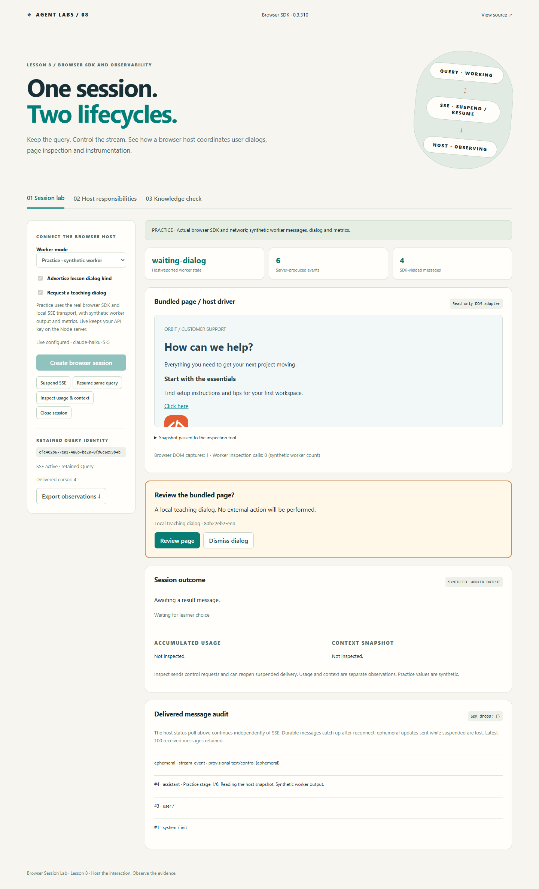
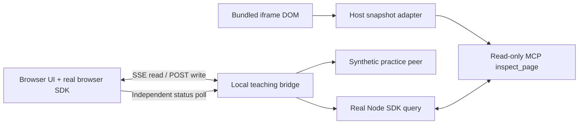
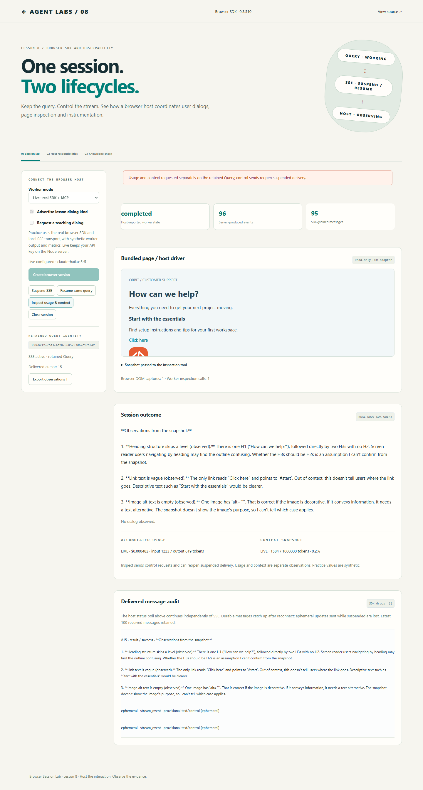

# Lesson 8 — Browser Session Lab

An interactive companion to **Claude Agent SDK TypeScript 0.3.310**, Lesson 8: **Browser SDK and Observability**.

Use the actual `@anthropic-ai/claude-agent-sdk/browser` package to retain a query, handle a learner dialog, suspend and resume SSE delivery, and inspect usage separately from context. A bundled help-center page gives the host a small, read-only DOM inspection task.

## Run the application

Requires Node.js **22.14+** or **24**, npm and a modern browser.

```sh
git clone https://github.com/luiscoco/claude-agent-sdk-lesson-08.git
cd claude-agent-sdk-lesson-08
npm ci
npm run dev
```

Open **http://127.0.0.1:4381**. Practice mode works immediately without credentials or model calls. The interface also includes a host-responsibility guide, four-question knowledge check, and downloadable observations.



## Try the core exercise

1. In **Practice**, uncheck **Request a teaching dialog** and create a session.
2. Click **Suspend SSE** while the worker is running. The SDK-yielded message count stops increasing, while the independently polled host state and server event count continue.
3. Wait for the host worker to complete. The result has not reached the suspended browser query yet.
4. Click **Resume same query**. Check that the retained query identity has not changed and durable output catches up. Ephemeral updates sent while suspended are not replayed.
5. Click **Inspect usage & context**. Both practice snapshots are explicitly synthetic. These control sends can reopen a suspended stream, so they are not passive reads of local state.
6. Close the session. Create another session with the dialog enabled, answer it, then compare with **Advertise lesson dialog kind** disabled.

See the full [student walkthrough](docs/walkthrough.md) for exercises and instructor answers.

## What is real in each mode?

| Component                        | Practice                       | Live                                                 |
| -------------------------------- | ------------------------------ | ---------------------------------------------------- |
| Installed browser SDK `query()`  | Actual package                 | Actual package                                       |
| Local GET SSE / POST transport   | Real network transport         | Real network transport                               |
| Browser reads bundled iframe DOM | Actual DOM capture             | Actual DOM capture                                   |
| Remote worker                    | Synthetic local teaching peer  | Actual Node SDK query behind the local bridge        |
| Inspection tool                  | Synthetic worker counter       | Actual SDK-hosted MCP tool returns captured snapshot |
| Worker messages / final analysis | Synthetic and labeled          | Actual model output, projected to selected fields    |
| Usage and context                | Synthetic and labeled          | Actual SDK control-method snapshots                  |
| Learner dialog                   | Custom local teaching protocol | Disabled in the standard live exercise               |

The local peer implements a **narrow teaching subset** of the browser transport protocol: initialize, one fixed task, one custom dialog, usage/context controls and cleanup. It is not Anthropic's hosted-session service, a generic remote CLI proxy, or an implementation of the complete protocol. This keeps the lesson runnable without provisioning a remote service. The browser SDK's stream controls themselves are real in both modes.



## Browser SDK contract in this version

The lesson slides use conceptual shorthand. The compiled example uses the installed **0.3.310** public declarations:

```ts
import { query, suspendSseStream, resumeSseStream } from '@anthropic-ai/claude-agent-sdk/browser';

const q = query({
  prompt: messageStream, // AsyncIterable<SDKUserMessage>, kept open by the host
  sse: { streamUrl, sendUrl, sessionId }, // exactly one SSE or WebSocket transport
  supportedDialogKinds: ['lesson_page_review'],
  onUserDialog: renderLessonDialog,
});

await q.initializationResult();
// Enqueue the task into messageStream, then observe q with for await.
suspendSseStream(q);
resumeSseStream(q); // retain this exact Query object

await q.getContextUsage({ detail: 'summary' });
await q.usage_EXPERIMENTAL_MAY_CHANGE_DO_NOT_RELY_ON_THIS_API_YET({
  skipBehaviors: true,
});
```

There is **no assumed `getUsage()` alias**: the actual usage method is explicitly experimental in this release. Online guides can describe newer versions; this repository is pinned and compile-checked against 0.3.310.

`supportedDialogKinds` advertises exactly the dialog kinds the host can render. Providing `onUserDialog` alone does not opt in. A non-empty list requires a callback. Our `lesson_page_review` is a custom local teaching kind, not a Claude-defined dialog. Unknown kinds return `null` and remain unanswered; a learner explicitly dismissing a recognized dialog returns `{behavior:'cancelled'}`. This follows the installed callback/control-request fail-closed contract; an older comment on `UserDialogRequest` in the same package suggests cancelling unknown kinds, which would incorrectly settle an undeclared dialog. The host cancels pending UI when its abort signal fires.

The published browser bundle reads `process.env` at import time. `src/client/process-shim.ts` supplies inert browser defaults before importing it; it never copies the Node environment or credentials. The SDK bundle accounts for most of the roughly 900 KB uncompressed client JavaScript. Vite's chunk-size advisory is expected for this teaching app.

## Two distinct lifecycles

- **Query work:** the worker may continue processing while no SSE client is attached. Suspending delivery does not cancel work or stop billing. A remote permission or dialog request can instead leave work waiting for an answer.
- **Event delivery:** `suspendSseStream(q)` closes that delivery connection. `resumeSseStream(q)` reopens it; the next send, including a control request or dialog response, can reopen it too. Already queued messages may still reach the iterator immediately after suspension.

The peer retains its latest 200 durable events, assigns sequence numbers and replays after `Last-Event-ID`. It does not retain ephemeral frames. A cursor older than retained history produces `catch_up_truncated`; the UI marks the audit incomplete. This sample does not implement a separate full event-history recovery API. The SDK's delivered cursor can skip numbers because control frames are handled internally. The UI retains the latest 100 yielded message summaries, preserving wire-envelope metadata through `getCcrEvent(q, message)` on the exact yielded object.

**Close session** explicitly closes the browser Query **and** deletes the server session to release worker resources. A disconnected SSE client alone does not delete it. Sessions expire after ten minutes; the host admits up to six retained sessions and one active live session. Every live query has a 90-second timeout, four-turn limit and $0.25 SDK budget.

## Enable live mode

Copy `.env.example` to `.env` and use your own API credentials:

```dotenv
ANTHROPIC_API_KEY=your-key-here
ANTHROPIC_MODEL=your-API-accessible-model-id
PORT=4381
```

Restart the host, choose **Live**, and create a session. The browser captures the actual bundled page's title, heading levels, links and image alt text. The host validates and bounds that snapshot; its MCP tool exposes only this read-only data. There are no built-in shell or edit tools and no arbitrary navigation URLs, prompts or file paths. This is a DOM snapshot adapter, not general browser/computer automation. A production automation host would need its own navigation/action driver and policies.

The API key stays in the local Node process and its SDK child environment. `.env` and `.local` are ignored by Git and denied by Vite. The API binds to loopback and checks request origin/host. Selected-field message projection omits hidden reasoning, raw tool arguments and raw tool-result bodies. The snapshot itself is visible in the UI and export.

Live accumulated cost and ordinary input/output token totals are separate from context-window occupancy; cache-specific token categories are not displayed. Context uses `detail:'summary'`, whose breakdown contains local estimates rather than full per-category token-count calls. The displayed percentage is derived from total/max counts. Final snapshots are cached before the Node query is closed, so post-completion inspection does not issue controls on a closed query. Instrumentation failures show **Unavailable**, independently of a successful task result. API-key sessions normally have no subscription rate-limit windows.



## Source map

| File                    | Responsibility                                                |
| ----------------------- | ------------------------------------------------------------- |
| `src/client/browser.ts` | Actual browser SDK query, retained handle and stream controls |
| `src/client/dialog.ts`  | Host-rendered dialog, choice, dismissal and abort handling    |
| `src/client/driver.ts`  | Bounded DOM inspection of the bundled iframe                  |
| `src/server/wire.ts`    | Local durable SSE log, ephemeral delivery and resume cursors  |
| `src/server/session.ts` | Narrow protocol peer, synthetic worker and control replies    |
| `src/server/live.ts`    | Real Node SDK/MCP runtime, instrumentation and cleanup        |
| `src/server/app.ts`     | Loopback HTTP API, admission and validation                   |
| `src/shared/model.ts`   | Shared schemas, lesson guide and quiz                         |

## Validation

```sh
npm run check        # typecheck, unit/HTTP tests, production build
npm run api:check    # pinned package + compile-checked browser contract
npx playwright install chromium
npm run test:e2e     # actual browser SDK, SSE reconnect and dialogs
npm run live:smoke   # one explicitly billable real SDK run
npm start           # serve the production build
```

The CLI live smoke test uses an explicit fixture snapshot; the UI live exercise captures the DOM. Tests in CI use practice or injected inputs and require no API key. GitHub Actions runs Node 22 and 24 checks and Chromium browser exercises. To use an existing Chrome installation locally in PowerShell, set `$env:PLAYWRIGHT_CHANNEL='chrome'` before running browser tests.

See [live verification](docs/live-verification.md) for separately observed real SDK evidence. Replay/synthetic tests do not establish model behavior.

## Primary references

- [Official TypeScript SDK changelog](https://github.com/anthropics/claude-agent-sdk-typescript/blob/main/CHANGELOG.md): browser stream controls in 0.3.304 and dialog declarations in 0.3.307.
- Installed package `browser-sdk.d.ts` and `sdk.d.ts`: exact public contracts for this pinned release.
- [Official browser/computer toolset guide](https://platform.claude.com/docs/en/agents-and-tools/tool-use/browser-use-sdk): host driver responsibilities. These API toolsets are a separate surface from the Agent SDK browser transport demonstrated here.

MIT license. Public student repository; instructor credentials are not included.
